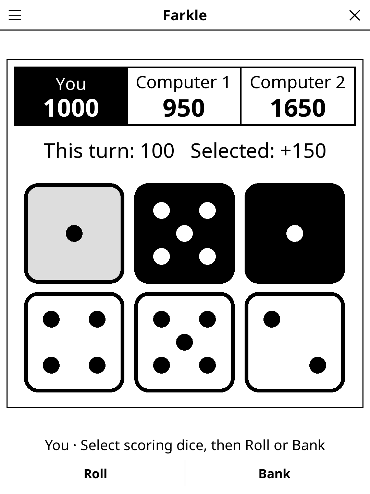

# Farkle — KOReader Plugin

> Push-your-luck dice game to 10,000 points (Dix mille / 10000 in French).
> Hotseat for 2-4 players, with computer opponents at three levels.

## Screenshot

## Rules

On your turn, roll the six dice and set aside at least one scoring die. Then
roll the remaining dice to add more, or **bank** to add the turn's points to
your score. A roll with no scoring die at all is a **farkle**: the turn's
points are lost and the turn passes. When all six dice have been set aside
(**hot dice**), you may roll all six again and keep going.

The first player to bank **10,000** or more triggers the last round: every
other player gets one final turn, and the highest score wins. There is no
minimum score to "get on the board".

### Scoring

This plugin uses one common rule set, the one printed in the Smart Box /
"Farkle Pack" edition (also the scoring listed on Wikipedia). Only dice set
aside from the same roll combine.

| Combination | Points |
|-------------|--------|
| Each 1 | 100 |
| Each 5 | 50 |
| Three of a kind | face × 100 (three 1s: 1,000) |
| Four of a kind | 1,000 |
| Five of a kind | 2,000 |
| Six of a kind | 3,000 |
| Straight 1-2-3-4-5-6 | 1,500 |
| Three pairs (a four of a kind with a pair counts) | 1,500 |
| Two triplets | 2,500 |

A selection is always scored at its best reading: four 1s count as three 1s
plus a single 1 (1,100), not as a four of a kind (1,000). Every selected die
must score.

## Controls

| Action | Control |
|--------|---------|
| Roll (all six at the start of a turn, the rest afterwards) | **Roll** |
| Select / deselect a die to set aside | tap it (selected dice are black) |
| Bank the turn | **Bank** |
| Players, computers, difficulty, new game, rules | title-bar menu |

Dice set aside earlier in the turn are grey. The line above the dice shows
the turn's points and what the current selection adds. After a turn, its
dice stay on show until the next player rolls, so a farkle can be seen.

## Computer players

| Level | Dice kept | When it banks |
|-------|-----------|---------------|
| Easy | every scoring die | as soon as the turn is worth 350 |
| Medium | combinations, and only the best single 1 or 5 unless that gives hot dice | threshold by dice left: 300 (1-2 dice), 400 (3), 1,000 (4), 2,000 (5), never with 6 |
| Hard | whatever maximises the turn's expected points | exactly when banking beats rolling on |

Hard solves the turn by backward induction once per session (points in
steps of 50 up to 12,000 × dice left; ~30 ms here, ~100 ms with the JIT
off), then every decision is a table lookup. All levels bank a total that
reaches 10,000, and in the last round keep rolling until they are ahead of
the leader.

Measured over 5,000 two-player games per pairing, alternating who starts
(dice random, so every game is different):

| Match | Win rate |
|-------|----------|
| Easy vs random | 99.1 % |
| Medium vs random | 99.6 % |
| Hard vs random | 99.6 % |
| Medium vs Easy | 64.9 % |
| Hard vs Easy | 74.6 % |
| Hard vs Medium | 59.1 % |
| Hard vs Hard (first player) | 53.5 % |

Average points per turn: random 217, Easy 474, Medium 555, Hard 608.
Worst whole computer turn: under 1 ms after the table is built.

## License

GPL-3.0
